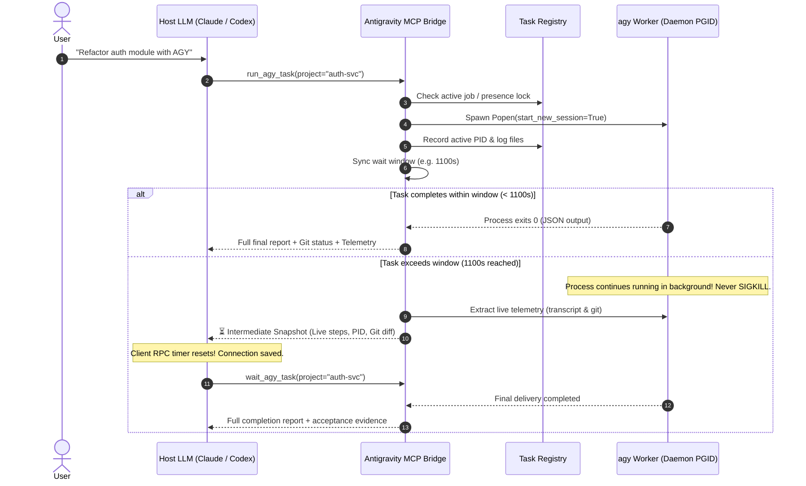

# Antigravity MCP Bridge 🌉

> **Universal Daemon & Resilient Orchestration Bridge connecting Google Antigravity (AGY) with Claude, OpenAI Codex, ChatGPT, Cursor, and Cline.**

[](LICENSE)
[](https://modelcontextprotocol.io/)
[](https://www.python.org/downloads/)

---

## ⚡ The Problem: The Long-Running Agent Timeout Dilemma

Autonomous coding agents (like **Google Antigravity / `agy`**) perform deep multi-step loops: reading directories, exploring source code, modifying multiple files, and executing test suites. For complex composite workflows, a single task can easily run for **5 to 20 minutes** (100+ iterative steps).

However, host LLM clients (**Claude Desktop, Claude Code, OpenAI Codex, ChatGPT, Cursor**) enforce strict client-side RPC timeouts (typically **60s to 1200s**).

When standard MCP bridges wrap CLI tools using synchronous `subprocess.run(timeout=...)`, hitting the timeout sends a hard `SIGKILL`. This results in:
- ❌ **Mid-flight termination**: 95%+ of completed work is killed right before completion.
- ❌ **Token wastage**: Tens of thousands of output tokens and millions of cache reads burned in vain.
- ❌ **Opaque failures**: The host LLM receives a generic timeout error without knowing what files were actually changed.

**Antigravity MCP Bridge** solves this with an architectural **Daemon / Job Orchestration Pattern**.

---

## 🚀 Key Architectural Features



### 1. 🛡️ Daemon / Job Execution Model
Tasks run in an independent POSIX process group (`start_new_session=True`). The bridge never sends `SIGKILL` on client timeouts. Your agent keeps running smoothly in the background until the job is done.

### 2. 💓 Anti-Timeout Telemetry Pulse
Before the client's RPC window closes (capped at 1100s), the bridge safely harvests live progress from `transcript.jsonl` and `git status`, returning a structured intermediate progress report. This **resets the client's RPC timeout timer** and returns control to the Supervisor.

### 3. 🔒 Concurrency & SQLite Presence Lock Safety
AGY acquires an SQLite presence lock per session. The bridge automatically checks `task_registry.json`. If a task is already running, subsequent calls automatically **attach to monitor the existing job** rather than spawning colliding duplicate processes.

### 4. 🔄 Automated 429 & Context Bloat Handoff
When a session exceeds turn thresholds (e.g. 100 turns) or hits Google API quotas (`429 RESOURCE_EXHAUSTED`), the bridge automatically inspects the workspace, writes an authoritative zero-LLM Markdown handoff document, and rotates to a fresh session seamlessly.

### 5. 🌐 Universal Multi-Client Agent Hub
`task_registry.json` is shared on disk. You can trigger a task from **Claude Desktop**, monitor it in **Claude Code**, and inspect it in **OpenAI Codex** without context loss.

---

## 📦 Installation

```bash
# 1. Clone repository
git clone https://github.com/SuperGODOG/antigravity-mcp-bridge.git
cd antigravity-mcp-bridge

# 2. Create virtual environment & install dependencies
python3 -m venv .venv
source .venv/bin/activate
pip install -e .
```

### Environment Variables (Optional)

| Variable | Description | Default |
| :--- | :--- | :--- |
| `AGY_PATH` | Path to `agy` binary | Auto-detected (`shutil.which` or `~/.local/bin/agy`) |
| `AGY_BRIDGE_DATA_DIR` | State storage directory | `~/.agy-bridge` |
| `AGY_PROXY_URL` | Outbound proxy for Google APIs | System environment / `http://127.0.0.1:7897` |
| `AGY_SYNC_TIMEOUT` | Max synchronous wait before snapshot (seconds) | `1100` |
| `AGY_MAX_TURNS` | Max turns before automatic session handoff | `100` |

---

## 🔌 Client Setup Guide

### 1. Claude Desktop (macOS / Windows)
Add to your `claude_desktop_config.json` (`~/Library/Application Support/Claude/claude_desktop_config.json` on macOS):

```json
{
  "mcpServers": {
    "antigravity-bridge": {
      "command": "/path/to/antigravity-mcp-bridge/.venv/bin/python",
      "args": ["-m", "agy_mcp_bridge"]
    }
  }
}
```

### 2. Claude Code (CLI)
Add with one command:

```bash
claude mcp add antigravity-bridge /path/to/antigravity-mcp-bridge/.venv/bin/python -m agy_mcp_bridge
```

### 3. OpenAI Codex CLI
Add to `~/.codex/config.toml`:

```toml
[mcp_servers.antigravity-bridge]
command = "/path/to/antigravity-mcp-bridge/.venv/bin/python"
args = ["-m", "agy_mcp_bridge"]
enabled = true
tool_timeout_sec = 1200
```

### 4. Cursor / Windsurf / Cline
In Cursor `settings.json` or Cline MCP settings:

```json
{
  "mcpServers": {
    "antigravity-bridge": {
      "command": "/path/to/antigravity-mcp-bridge/.venv/bin/python",
      "args": ["-m", "agy_mcp_bridge"]
    }
  }
}
```

---

## 🛠️ MCP Tool Reference

| Tool Name | Parameters | Description |
| :--- | :--- | :--- |
| `run_agy_task` | `instruction`, `project_name`, `workspace_path`, `conversation_id`, `mode`, `timeout_seconds` | Dispatches task to AGY with daemon persistence and auto-attach. |
| `wait_agy_task` | `project_name`, `workspace_path`, `timeout_seconds` | Blocks and waits for an active background job to finish. |
| `abort_agy_task` | `project_name`, `workspace_path` | Terminates the process group (`os.killpg`) of a running task. |
| `get_agy_status` | `project_name`, `workspace_path` | Non-blocking live telemetry (PID, duration, steps, Git status). |
| `get_task_registry` | *(none)* | Lists all tracked projects, bound session IDs, and active PIDs. |
| `list_recent_agy_conversations` | `limit` | Audits raw physical sessions from the local AGY brain directory. |

---

## 🧪 Testing

Run the included verification suite:

```bash
.venv/bin/python tests/test_bridge.py
```

Expected output:
```text
[TEST] Checking config resolution...
  -> Discovered agy binary: /Users/.../.local/bin/agy
[PASS] Config resolution OK
[TEST] Testing registry operations...
[PASS] Registry operations OK
[TEST] Testing process lifecycle...
[PASS] Process lifecycle OK
[TEST] Testing MCP tool registrations...
  -> Successfully registered 6 tools
[PASS] MCP tool registration OK

✨ ALL ANTIGRAVITY MCP BRIDGE TESTS PASSED! ✨
```

---

## 📄 License

This project is licensed under the [MIT License](LICENSE).
